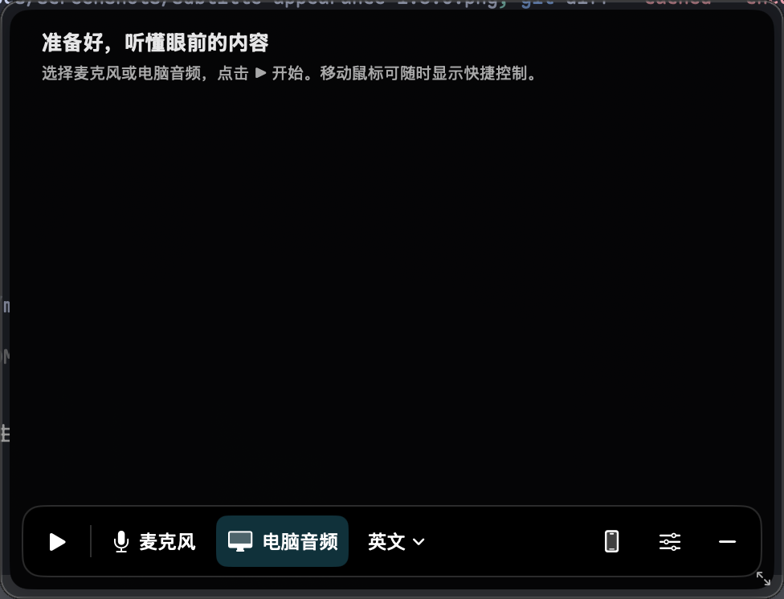
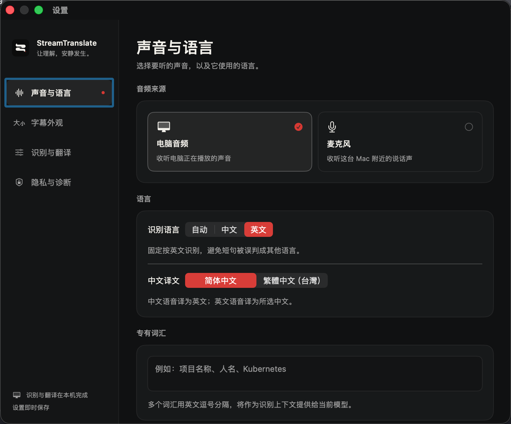

# StreamTranslate

StreamTranslate shows live English↔Chinese subtitles over other Mac apps. It can listen to audio playing on the Mac or to nearby speech through the microphone. Recognition and translation run on the Mac.

## Screenshots

**Floating subtitle window** — choose computer audio or the microphone, then start listening.



**English→Chinese captions** — the following native preview uses example text, not a recording.


**Audio and language settings** — select the audio source, recognition language and Chinese translation style.



[View subtitle appearance settings](docs/screenshots/subtitle-appearance-1.6.0.png).

## Latest update · 1.8.0

- The collapsed **总结** tab opens independent topic trees. Advertisements, discussion and uncertain content have separate roots; advertisements start as compact folded rows. Click topics or branches to expand them, or copy the outline.
- New content adds points to its topic; new roots stay separate even when their titles match, and returning subjects can extend earlier topics. Existing titles and tree order stay fixed. Source corrections replace only dependent points.
- While expanded, the summary updates automatically from the current session's complete saved original text, including captions beyond the 100-row live cache. First expansion starts immediately; later changes coalesce for two seconds and draft text appears as it is generated.
- **暂停**, **继续** and **重试** control automatic updates. With private API configuration, summaries use the cloud first and automatically fall back to the existing local Qwen3-4B-Instruct-2507 on failure. A successful cloud request never loads the local summary model. The header identifies the active mode. Without API configuration, summaries remain local.
- Cloud summaries send new source-text batches and topic labels to the configured provider; audio, recognition, source review and translation retain their existing local paths. Credentials stay in ignored `.env` files outside the app bundle. See [summary API configuration and fallback](docs/cloud-summary-1.8.0.md).
- The summary overlays the subtitle window without resizing its text width. AI topic classification and wording can be wrong; check the original captions. At 300 topics or 6,000 facts, additions pause before exceeding the limit and retain the previous completed map; the full transcript stays available.

See [summary installation, behavior and verification limits](docs/conversation-summary-1.7.0.md).
Saved text history was introduced in 1.6.1; older diagnostic sessions are not imported. See
[long-session history and verification limits](docs/long-session-history-1.6.1.md),
[settings redesign](docs/settings-redesign-1.6.0.md),
[remote phone setup](docs/remote-companion-1.5.0.md) and
[Home Screen recovery](docs/bookmark-recovery-1.5.1.md).
Relay deployment files contain **example host/account values**, not a provisioned public service.
Model weights, credentials, machine provisioning and generated release binaries are not in this repository.

Fixed English and Mandarin have Apple's continuous on-device speech transcriber. An optional Nemotron Metal backend offers another English streaming path; it can omit long stretches of far-field meeting audio that Apple Speech recognizes, so Apple remains the fixed-English default. WhisperKit remains available for automatic-language detection and manual multilingual recognition.

## Current behavior

- English speech → streaming English transcript → simplified or Taiwan traditional Chinese
- Apple SpeechAnalyzer and optional Nemotron both process each audio chunk once and preserve recognizer state across long utterances
- A confirmed prefix stays fixed during speech; the authoritative final transcript may correct it at the sentence boundary
- A conservative prefix starts draft translation before the whole sentence is final
- Changed eligible prefixes have a 600 ms scheduling deadline, without translating isolated English words or fewer than four Chinese characters
- Final source text enters transcript history immediately; translation updates the same caption ID later
- Final translations use Apple Translation's identified batch API, so slow or out-of-order responses cannot overwrite another caption
- Stopping native streaming recognition closes the audio stream and waits for final words and queued translations before ending the session
- Whisper Small and Large-v3 Turbo remain selectable for Chinese, automatic language detection, and comparison
- Microphone and ScreenCaptureKit watchdogs rebuild stalled capture after about three seconds
- Audio, speech recognition, and translation stay on the Mac
- Optional Qwen source review and bidirectional Hy-MT final refinement update the same caption; guarded revisions, timeouts and memory-pressure fallback retain the fast system path
- Optional conversation summaries update automatically while their drawer is expanded, use the full current-session original transcript, and are not saved across app relaunches

The transcription/translation pipeline uses network access to install missing language assets or optional models/runtimes. Enabling phone subtitles also requires a LAN connection or, for the optional remote relay, Internet access. Audio recognition and translation processing remain local. Configured cloud summaries upload source-text batches and topic labels to the selected provider.

## Requirements

- Apple Silicon Mac running macOS 26.0 or later
- Xcode 26.0 or later, or Command Line Tools with Swift 6 and the macOS 26 SDK, for source builds
- Microphone permission for nearby speech
- Screen Recording permission for System Audio mode
- English and Chinese Apple Translation language assets
- About 700 MB free space per optional Whisper model and compiled Core ML cache
- About 1 GB free disk space and about 1.05 GB process RSS for optional Nemotron

The latest enhancement tests use an Apple M4 with 16 GB unified memory on macOS 26.4. Apple Speech + Apple Translation is the fast base path. Installed optional Qwen 0.6B / Hy-MT 1.8B models load during capture and release on stop or memory pressure. They are separate native Metal processes; their memory is not included in the app's own RSS. macOS 26.4 uses the low-latency Translation strategy; earlier supported systems retain their existing strategy.

## Build and run

For drag-to-Applications distribution, build the **full-model DMG** with
`zsh scripts/build-dmg.sh /path/to/output-directory` (10 GiB staging space).
It includes the pinned Qwen / Hy-MT weights and native runtimes inside the App,
with no development-machine model symlinks. See [DMG distribution](docs/dmg-distribution.md)
and [recipient installation instructions](docs/dmg-install-zh.txt).
The default locally signed build is **not Apple-notarized**; a Developer ID
certificate and notarization are required for the normal trusted distribution workflow.
Source/local builds below remain small and use separately installed models.

To build and install with either Xcode or Command Line Tools:

```bash
./scripts/install-local.sh
```

This builds a Release app, signs it with a persistent local identity, installs it
at `/Applications/StreamTranslate.app`, and launches it. macOS may ask you to
trust the local signing certificate. With Command Line Tools only, the installer
uses the Swift package in `Package.swift`; no Xcode download is needed. To build
the unsigned app bundle without installing, run `./scripts/build-app.sh` (output:
`build/StreamTranslate.app`). The unit test suite additionally needs Swift Testing
(bundled with full Xcode); Command Line Tools alone can build the app but may not
provide the `Testing` module.

The installer retains the previous signed app at `/Applications/StreamTranslate.app.previous` for rollback. Older rollback copies are archived under `build/app-backups/` on subsequent installs.

For the Xcode workflow:

```bash
brew install xcodegen
cd /path/to/StreamTranslate
xcodegen generate
xcodebuild build \
  -project StreamTranslate.xcodeproj \
  -scheme StreamTranslate \
  -destination 'platform=macOS' \
  -configuration Debug
```

Open the built app from Xcode or run:

```bash
open ~/Library/Developer/Xcode/DerivedData/StreamTranslate-*/Build/Products/Debug/StreamTranslate.app
```

For repeated local installation into `/Applications`, use the stable local signing identity so macOS does not treat each build as a new privacy principal:

```bash
./scripts/install-local.sh
```

## Recommended English→Chinese settings

1. Select **System Audio** for calls or media playing on the Mac; select **Microphone** for nearby speakers.
2. Keep recognition language on **English**.
3. Select **英译中流式 / Apple Speech English** for the tested low-memory enhancement combination. **英文流式 Metal（本机安装） / Nemotron Streaming English** remains an optional comparison, not a universal first-translation speed winner.
4. Add names, product names, abbreviations, and technical terms to **Vocabulary**, separated by commas or new lines.
5. Start from the menu bar or press `Cmd+Shift+T`.

The microphone sensitivity picker applies only to the Whisper path. Apple Speech and Nemotron consume a continuous stream and perform their own phrase finalization.

Install the pinned official NeMo-Speech.cpp Metal runtime and English Q8 model:

```bash
./scripts/install-nemotron.sh
```

The installer supports Apple Silicon only, verifies both SHA-256 checksums, and stores assets under `~/Library/Application Support/StreamTranslate/Nemotron`. The runtime uses the M4 GPU through Metal; it does not use Core ML or the Neural Engine. The measured cold preload was about seven seconds. The app keeps Apple Speech as the installation-free default and reports a direct installation error if Nemotron assets are absent.

For fixed Mandarin, select **中译英流式 / Apple Speech 中文**. Switching a fixed English native model to Chinese selects this native Chinese profile. Selecting automatic mode switches incompatible native models to **Whisper Small**. Explicitly selected Whisper models are preserved when changing languages. **Large-v3 Turbo** remains optional when its higher per-pass latency is acceptable. If Apple speech assets are unavailable or recognition is unsuitable for the content, manually select Whisper as the fallback.

## Data flow

```text
Microphone / System Audio → 16 kHz mono chunks
    ├─ fixed English + Nemotron model
    │    → NeMo-Speech.cpp Metal streaming state
    │    → partial/final English results
    ├─ fixed English or Mandarin + matching Apple model
    │    → SpeechAnalyzer streaming state
    │    → volatile/final ranges in the selected language
    └─ automatic or manually selected Whisper model
         → adaptive endpointing
         → coalesced snapshot recognition
    → frozen prefix + editable suffix
    → latest-only draft translation
    → authoritative final source → ID-matched batch final translation
    → floating subtitles + transcript history
```

For a first partial, translation may use all but the last two English words. This prefix is not displayed as frozen until independent audio evidence confirms it. A 30 ms debounce merges groups of subword hypotheses emitted in one callback burst.

Drafts need at least two English words or four Chinese characters. A changed eligible prefix waits at most 600 ms in the scheduling policy, even if no further ASR callback arrives. Its deadline is anchored to the previous request; if already elapsed, the new candidate is submitted immediately. Newer pending text does not extend the deadline. This is a scheduling bound, not a promise of 600 ms end-to-end latency. Finalization, clear-history and segment/language changes cancel obsolete deadlines.

The 1.1 implementation and local measurements are documented in [the enhancement verification report](docs/enhancement-1.1-verification-2026-09-05.md). Open Settings using the menu-bar action or the standard macOS **⌘,** shortcut.

## Verification

Run the unit and integration suite:

```bash
xcodegen generate
xcodebuild test \
  -project StreamTranslate.xcodeproj \
  -scheme StreamTranslate \
  -destination 'platform=macOS' \
  CODE_SIGNING_ALLOWED=NO
```

For 1.8.0, 371 sequential tests passed, including 45 summary-related tests, with the same eight exclusions below. The configured API passed the five-stage synthetic SSE/apply replay in 8.181 seconds without starting a local summary worker. Release, local installation of 1.8.0/build 26, strict signing and credential-exclusion checks passed. See [cloud summary verification and limits](docs/cloud-summary-1.8.0.md).

Historical 1.7.3 verification: 360 sequential tests passed, including 34 summary-focused tests, excluding seven shared-log tests and one installed-translation fixture. Nine summary previews, a five-stage production-model replay, Release build, local installation of 1.7.3/build 25 and strict signature verification passed. The synthetic replay does not establish general classification accuracy or real ASR concurrency. See [verification and limits](docs/conversation-summary-1.7.0.md).

Historical 1.7.2 verification: 346 sequential tests passed, including 20 summary-focused tests, excluding seven shared-log tests and one installed-translation-assets test. Synthetic-text model inference, 300/620pt previews, Release build, local installation of 1.7.2/build 24 and strict signature verification passed. The model still produced unsupported wording, and real ASR concurrency remains unverified.

Historical 1.7.1 verification: 339 tests passed sequentially, including 13 summary tests, excluding the same seven shared-log tests and one installed-translation-assets test. Release build, local installation of 1.7.1/build 23 and strict signature verification passed. Synthetic-text inference streamed successfully; known summary misstatements and untested real ASR concurrency remain documented.

For the 1.6.1 local verification, 326 tests passed with `swift test --no-parallel --skip 'AppLoggerTests|companionInstalledTranslationRunsWithoutAnyWindow'`. The seven shared-log tests were excluded to preserve diagnostic evidence; the installed-assets translation test reported `notInstalled` in the test process. See [verification limits](docs/long-session-history-1.6.1.md).

On a CLT-only Mac, run the core test bodies using the explicit sequential assertion adapter:

```bash
python3 Tools/run_portable_tests.py
```

This is not the Swift Testing runner. It reports the core test bodies it executes and the four excluded UI/shared-log files; full Xcode tests and real UI/capture checks remain separate.

To exercise the production Chinese recognizer, caption state and installed translation assets without capturing live audio:

```bash
python3 Tools/build_local_tool.py Tools/EnhancementReplayMain.swift build/enhancement-replay/EnhancementReplay
build/enhancement-replay/EnhancementReplay /path/to/16k-mono.wav zh
```

Build the replayable ASR benchmark:

```bash
xcodebuild -project StreamTranslate.xcodeproj \
  -scheme StreamTranslateASRBench \
  -configuration Release \
  -destination 'platform=macOS' build \
  CODE_SIGNING_ALLOWED=NO

StreamTranslateASRBench /path/to/audio.wav \
  --reference "verbatim English reference" --realtime

# Long-run Apple-only replay
StreamTranslateASRBench /path/to/audio.wav \
  --reference "verbatim English reference" --realtime \
  --repeat 25 --gap-seconds 1.2 --apple-only
```

Build and run the optional Nemotron benchmark after installation:

```bash
xcodebuild -project StreamTranslate.xcodeproj \
  -scheme StreamTranslateNemotronBench \
  -configuration Release \
  -destination 'platform=macOS' build \
  CODE_SIGNING_ALLOWED=NO

StreamTranslateNemotronBench /path/to/audio.wav \
  --reference "verbatim English reference" --realtime --sessions 2
```

Build and run the installed Apple Translation benchmark:

```bash
xcodebuild -project StreamTranslate.xcodeproj \
  -scheme StreamTranslateTranslationBench \
  -configuration Release \
  -destination 'platform=macOS' build \
  CODE_SIGNING_ALLOWED=NO

StreamTranslateTranslationBench
StreamTranslateTranslationBench --batch
StreamTranslateTranslationBench --input /path/to/one-english-sentence-per-line.txt
```

The retained local measurements and model decisions are in [`docs/benchmark-2026-09-04.md`](docs/benchmark-2026-09-04.md).

## Session diagnostics

Enable **Settings → Diagnostics** only for a measured session. The app writes `source-audio.wav`, `capture.jsonl`, and `pipeline.jsonl` under `~/Library/Logs/StreamTranslate/Sessions/` and automatically prunes old data.

Analyze one session with:

```bash
python3 Tools/analyze_session.py \
  ~/Library/Logs/StreamTranslate/Sessions/<session-directory>
```

The report includes capture gaps, first/p50/p95 capture-to-stage latency, operation time, partial rewrites, visible deletions, peak physical footprint, and pipeline errors.

## Project structure

```text
StreamTranslate/
├── Models/                 settings, captions, stability, ASR types
├── Bridge/                 optional NeMo-Speech.cpp C ABI adapter
├── Services/               capture, native streaming ASR, Whisper, translation
├── Utilities/              logging, diagnostics, shortcuts
├── ViewModels/             pipeline scheduling and UI state
├── Views/ and Windows/     subtitle and settings UI
Tools/                      ASR, translation, and session-analysis benchmarks
StreamTranslateTests/       unit and integration tests
```

`project.yml` is the source of truth for the generated Xcode project.

## Known limits

- Apple streaming uses a fixed English or Mandarin locale, not automatic code-switching. Nemotron remains English-only; automatic routing uses Whisper.
- Nemotron is an optional Metal backend with about 1.05 GB measured process RSS versus 39 MB maximum RSS for the five-minute Apple benchmark. Semantic-normalized WER tied Apple on the five-voice synthetic set; the current evidence supports lower latency, not a general accuracy claim.
- Overlapping speakers are mixed into one audio stream.
- Vocabulary is recognition context, not a bilingual translation glossary.
- Apple Translation does not receive a bilingual glossary. On macOS 26.4 the app explicitly requests low latency. Optional native Hy-MT2 refinement and Qwen source review require separately installed runtimes/weights. This machine uses an external SSD for those assets; disconnecting it retains the system path. See [local use](docs/local-use-zh.md) and [1.2.1 verification](docs/refinement-1.2.1-verification-2026-09-05.md). Quality guards are conservative checks, not a guarantee that every refinement is more accurate.
- A different ad-hoc app signature can require Screen Recording and Microphone permission again; use `scripts/install-local.sh` for repeated installations.
- Full System Audio validation requires the user-granted Screen Recording permission and cannot be completed by a test process after macOS denies that prompt.

## Reading-first desktop controls (1.4.0)

Move the pointer over captions to reveal source, language, start/stop, phone,
settings and minimize controls. They fade after inactivity; interaction keeps
them available. Empty/paused views provide contextual feedback. Compact windows
offer the same actions with concise icons and accessible labels.

Quick source/language changes coordinate stop, configuration/model preparation
and optional restart. Idle selection never starts recording; stop cancels a
pending automatic resume. Transcript history and the phone conversation are
retained during a quick switch; actual audio may have a gap. Real permissions,
device switching and accessibility still require manual acceptance.
See [interaction rationale](docs/interaction-design-2026-09-06.md).

## iPhone private subtitle companion (1.3.0 development preview)

### No-signing web reader (Mac 1.3.2 / build 13)

For a trusted LAN, the Mac now offers **Quick connect → scan with iPhone Camera
→ read in Safari**, without installing an app or certificate. The Mac explicitly
asks for plaintext-HTTP consent; it never silently downgrades existing HTTPS.
Port 18444 uses an automatically selected LAN IP, one-use QR pairing and a
separate 12-hour, server-memory-only browser authorization. HTTP does not protect
captions or credentials from network attackers and cannot keep the phone awake.
Do not use this mode for public Wi-Fi or sensitive meetings. Service restart
requires a new scan; browser/network reconnect can resume while authorization
remains valid. WeChat and physical iPhone acceptance are not yet verified.

The advanced encrypted option serves a private HTTPS reader on port 18443. On an
iPhone, install the Mac-generated public certificate profile and explicitly
trust it, pair by a one-time QR/code, then add the page to the Home Screen.
No developer membership, weekly app re-signing, cloud server or domain purchase
is required. The certificate lasts one year; browser pairing lasts 90 days.
This is a LAN-only browser route, not the native Apple peer-to-peer path.

The listener rejects public source addresses, mismatched Host/Origin, ambiguous
HTTP framing and unauthenticated subtitle access. It uses TLS 1.3, HttpOnly
Secure cookies, bounded snapshot/delta SSE, heartbeats and reconnect snapshots.
Captions are rendered as text and kept out of browser persistent storage. No
service worker stores transcripts. Root signing keys are not persisted; only
the hostname-bound server leaf key is retained in the Mac keychain.

See [Chinese setup instructions](docs/web-companion-use-zh.md) and
[verification and release boundaries](docs/web-companion-verification.md).
The native iPhone implementation below remains available.

The Mac engine now supports window-independent translation sessions and a
persisted phone-only display mode. A native iPhone target, `StreamTranslatePhone`,
receives text over certificate-pinned TLS 1.3 with one-time pairing, revision-aware
updates, bounded queues and reconnect snapshots. Network discovery/serving is off
until enabled. Apple peer-to-peer Wi-Fi is opt-in and experimental.

This is **not yet a verified iPhone release**. Mac builds, protocol checks,
loopback TLS tests and unsigned native arm64/iPhoneOS builds pass. Five native
XCTest UI tests pass on iOS 26.5 Simulator; synthetic Bonjour/TLS captions,
relaunch recovery, session clearing and offline display were also checked in
the actual simulator app. See [no-phone verification](docs/phone-simulator-verification.md).
Device signing and wireless/lock-screen acceptance still require a configured
signing team and an actual iPhone. QUIC and automatic LAN/P2P switching
remain deferred until measured. See [setup and verification](docs/companion-development-status.md).

## License

[MIT](LICENSE)
